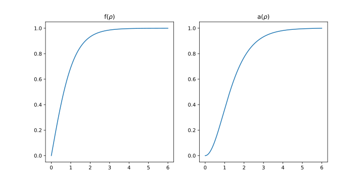

# Решение задачи основного BPS состояния вихря Абрикосова

# Решение задачи состояния $\lambda$ = 4.05

более высокие по отклонению значения $\lambda$ пока не удалось сделать, метод численно взрыввается.
